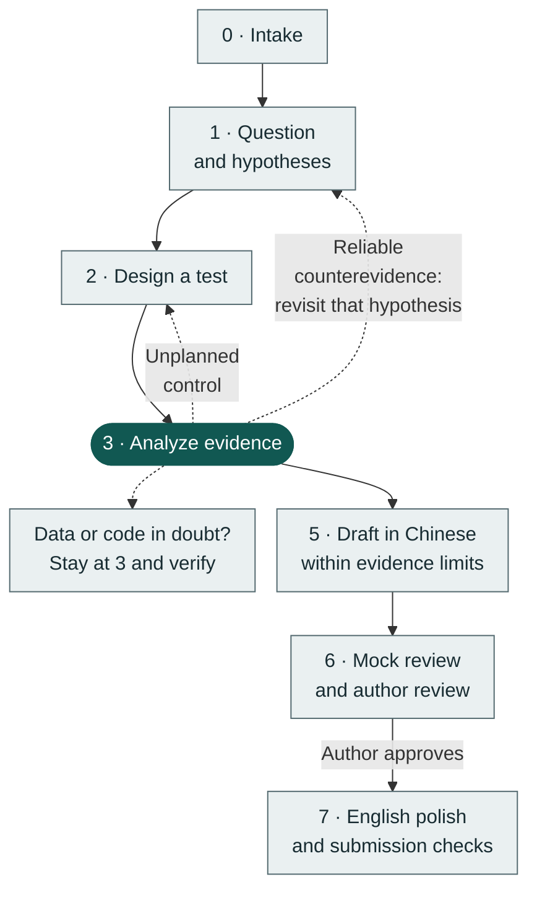

# Paper-build framework

[中文](README.md) | [English](README.en.md) | [Back to the root README](../README.en.md)

`10-paper-build/` organizes thirteen Skills in four source groups that turn research questions, evidence, and analysis into reviewable figures, Chinese author-review drafts, and final submission material. This document is the human entry point for the paper-build category; each Skill's `SKILL.md` remains its formal execution contract.

> The paper pipeline manages research arguments and deliverables. It does not perform the underlying research, invent data, or declare a scientific claim established because a figure, build, or polishing pass succeeded.

## Overall framework

Use evidence to answer the research question, then write the claim it supports. An existing project enters at its current stage; intake is not a restart button.



Solid lines show the main path; dashed lines show what to revisit. If the plan, budget and authorization already cover a missing control, add it at 3 without returning to 2.

**Optional branches:**

- **Literature** can refine the question or hypotheses. If nothing changes, return to the stage that requested the check.
- **Stage 4 · HTML brief** presents existing findings. Go straight from 3 to 5 when no progress report is needed.
- **Figures** start with a question at Stage 2. Once evidence is ready, `academic-figure-workflow` hands the Chinese draft editable sources, exports, captions, provenance and QA.

### Where do I resume after analysis?

Suppose A’s advantage is close to zero on large inputs. That number alone cannot tell you to change hypotheses. **First check whether the result is trustworthy. Then ask: is a control missing, or did a key prediction fail?**

| What you know | Where to go |
| :--- | :--- |
| **Suspect result.** Check sample, version or aggregation. | **Stay at 3.** Withhold the affected inference. Fix code that deviates from the plan. If the code followed an unfair design, repair that design at 2. |
| **Missing control.** The question and hypothesis still stand. | **Back to 2** for that comparison and its criterion. Go straight to 3 if the plan, budget and authorization already cover it. |
| **Failed prediction.** Reliable evidence contradicts the prediction within its scope. | **Back to 1, then 2.** Keep the question; reopen the affected hypothesis and design a test of rival explanations. Execute at 3 when authorized. Non-significance alone is not a refutation. |

**Another round or a stopping point?** Apply the same [after-analysis rule](workflow-tools/latex-paper-build-skill/references/paper-pipeline.md#after-analysis) to new evidence. Draft at 5 when the answer has a clear scope, even if it is negative. Pause the branch if evidence is insufficient and no feasible test remains. A derivation or a source check may suffice instead of an experiment. The author may open a separate question at 1; that does not authorize execution.

## Repeatable goal-clarification loop

Enter as needed at any stage: existing material/decisions → current blockers → smallest next action → return to the requested stage. Start with a light check; clear goals do not require an interview. This adds neither a stage nor a Skill.

`latex-paper-build-skill` owns activation, scope and return routing; `research-logic` handles scientific questions only. The single execution protocol is the [goal-clarification reference](workflow-tools/latex-paper-build-skill/references/goal-clarification.md); its interview rules are not duplicated here.

- Assess work goals, scientific questions, acceptance and action authority separately; negative results and insufficient evidence are permitted research outcomes.
- Reuse located decisions on reentry and reopen affected branches only. Confirm chat proposals conflicting with formal contracts rather than operating under both goals.
- `intake.md` holds the work goal or formal-contract pointer, `research_logic.md` the scientific question, and stage artifacts local decisions; `pipeline_context.md` only navigates.
- Unsaved chat is not guaranteed to survive another session. Missing fields in legacy workspaces do not trigger regeneration or insertion.

Example: “Use `latex-paper-build-skill` at the current figure stage. Clarify only unresolved figure information, reuse confirmed goals and permissions, then return to the figure workflow; do not rebuild the workspace.”

## First principles

1. **Claims precede evidence design.** Existing charts or convenient experiments cannot justify a stronger claim after the fact.
2. **Research execution is outside the paper Skills.** Computational, field, laboratory, qualitative, or other research is performed by project code, domain Skills, or human experts.
3. **Analysis and figure work have separate owners.** `data-analysis` determines whether data, statistics, and uncertainty are defensible; `academic-figure-workflow` turns approved material into figures.
4. **A figure expresses evidence; it is not the evidence itself.** Visual and structural QA cannot promote the scientific claim state.
5. **Review Chinese scientific content before English polishing.** Unless explicitly overridden, approve the science, boundaries, and figure/table intent before translation and venue adaptation.
6. **Simple projects remain simple.** Do not create empty directories, manifests, or ceremonial placeholders when figures, statistics, or HTML reports do not apply.

## Unique responsibilities of the thirteen Skills

The four directories locate Skill packages; they are not four workflow stages. Invocation names, standalone use and generated paper workspaces are unchanged.

| Source group | Skill | Owns | Does not own |
|---|---|---|---|
| `workflow-tools` | [`latex-paper-build-skill`](workflow-tools/latex-paper-build-skill/SKILL.md) | Pipeline orchestration, LaTeX architecture, figure placement, cross-references, and compilation | Reimplementing statistics or figure-generation logic |
| `workflow-tools` | [`paper-project-initializer`](workflow-tools/paper-project-initializer/SKILL.md) | Discover, preview, initialize minimal entries and hand off a selected stage | Research planning, implicit Hook enablement or rebuilding existing workspaces |
| `workflow-tools` | [`interactive-skill-builder`](workflow-tools/interactive-skill-builder/SKILL.md) | Skill creation through interviews, specification confirmation, approval gates, and validation | Producing a final Skill without author confirmation |
| `research-cycle` | [`research-logic`](research-cycle/research-logic-skill/SKILL.md) | Question ideation, logic challenge and conditional method integration | Automatic winners, implementation or hypothesis validation |
| `research-cycle` | [`literature-review`](research-cycle/literature-review/SKILL.md) | Discovery, screening, source appraisal and thematic synthesis | Treat limited search, DOI registration or review completion as scientific approval |
| `research-cycle` | [`literature-triage-matrix`](research-cycle/literature-triage-matrix/SKILL.md) | Compare a known set with source levels and unresolved checks | Certify coverage or equate relevance with quality |
| `research-cycle` | [`experiment-design`](research-cycle/experiment-design-skill/SKILL.md) | Research questions, evidence gaps, controls, ablations, metrics, and claim boundaries | Experiment execution, runners, or execution authority |
| `research-cycle` | [`data-analysis`](research-cycle/data-analysis/SKILL.md) | Data integrity, statistical tests, effect sizes, intervals, uncertainty, and reviewable interpretation | Presenting missing or unreliable data as a confident conclusion |
| `figures-and-reports` | [`research-html-report`](figures-and-reports/research-html-report/SKILL.md) | Standalone HTML research briefs, evidence plans, and risk displays | Replacing research design or manufacturing evidence |
| `figures-and-reports` | [`academic-figure-workflow`](figures-and-reports/academic-figure-workflow/SKILL.md) | Figure arguments, editable sources, style, exports, captions, evidence trace, and rendered QA | Inventing data, mechanisms, modules, or scientific support |
| `manuscript-review` | [`paper-audit`](manuscript-review/paper-audit/SKILL.md) | Completed-manuscript mock review and revision re-review, one evidence-anchored report | Automatic edits, research execution, author approval or real editorial decisions |
| `manuscript-review` | [`paper-polishing-skill`](manuscript-review/paper-polishing-skill/SKILL.md) | Translation, structural revision, and Nature/PRL/PRA polishing of approved content | Inventing data, citations, or stronger claims |
| `manuscript-review` | [`prl-manuscript-polisher`](manuscript-review/prl-manuscript-polisher/SKILL.md) | PRL compression, adaptation, and evidence calibration for a technically complete physics manuscript | Hiding weak evidence with stronger prose |

`latex-paper-build-skill` is the paper-pipeline orchestrator but does not own the other Skills' specialist capabilities. `interactive-skill-builder` is a peer utility, not a mandatory paper-lifecycle stage.

## Stages 0–7

| Stage | Enter when | Owner | Core artifact | Exit condition |
|---|---|---|---|---|
| 0 Intake and inventory | Initialization or attaching an existing paper | Initializer → LaTeX Pipeline | Intake/context or existing equivalents; config when needed | Goal source, permission, gaps and next stage are visible |
| 1 Logic and optional literature | Question, contribution, context or combination is unclear | logic / review / matrix | `research_logic.md`, requested literature artifacts | Question, source limits, candidates and unresolved decisions are explicit |
| 2 Experiment and evidence design | The claim is known but the evidence plan is weak | `experiment-design` | `experiment_plan.md`, optional Figure Evidence Plan | Every claim maps to evidence or an explicit TODO |
| 3 Research execution and analysis | Results must be produced or reviewed | Project/domain executor + `data-analysis` | Raw results, analysis code, statistics, and interpretation | Sources, units, transforms, uncertainty, and boundaries are reviewable |
| 4 Research brief | A shareable or printable plan is useful | `research-html-report` | Standalone HTML report | Claim, evidence matrix, risk, and TODOs are visible |
| 5 Figures and Chinese manuscript | Formal figures or manuscript structure are needed | Figure Skill + LaTeX Pipeline | Figure packets, `caption.md`, Chinese LaTeX manuscript | Paths, captions, prose interpretation, and build relationships resolve |
| 6 Mock pre-review and author gate | The complete manuscript and applicable figures exist | paper-audit → Author/domain expert | Applicable review, author decision and unresolved items | Version, coverage and findings are traceable; scientific approval remains human-owned |
| 7 English polishing and submission checks | Scientific content is author-approved | Polishing / PRL Skill | English manuscript and build/submission report | PDF, citations, figures, anonymity, and venue checks pass or expose gaps |

Completing a stage means only that its contract is satisfied. Work completion, data trustworthiness, figure quality, manuscript compilation, claim support, and publication authorization remain independent judgments.

## Whole-manuscript mock review and revision re-review

[paper-audit](manuscript-review/paper-audit/SKILL.md) works independently of the Pipeline, config or sibling Skills. Abstract-only input allows limited feedback, not completed whole-paper pre-review. It defaults to one read-only chat report; saving needs authorization. It does not edit manuscripts, add experiments or submit papers.

```text
Complete draft → Understand argument → Mock review → Counter-review → One report → Author decision
Revision + identifiable old report → Verify closure and impact → Re-review report → Author decision
```

The report distinguishes validity, contribution, expression and consistency. There are no concern quotas, predetermined positive results or narrative substitutes for evidence. An author's "fixed" is not closure evidence; inspect the revised draft and retain unknown history. A mock recommendation is not an editorial decision.

For mathematical or computational claims, [technical consistency](manuscript-review/paper-audit/references/technical-consistency.md) traces object identity, parameter ownership, first-use definitions, and agreement across prose, equations and algorithms. When figures carry methods or evidence, [figure review](manuscript-review/paper-audit/references/figure-review.md) checks correspondence in both directions and readability at the placed size in the final PDF. Supplied language versions are compared for scientific meaning. Findings identify locations, the reader's question, impact, the smallest remedy and observable closure conditions; the Skill remains the execution contract.

Stage 6 returns the report to the human gate. The Stage 7 shortcut and both direct polishers check applicable pre-review or equivalent human review before final whole-manuscript delivery; local edits, translation drafts and explicitly pending-review versions are exempt. After polishing, check semantic impact and reopen affected methods, data, evidence, formulas, figure meaning or claim strength. Permission to continue work does not make unchecked science pass.

Results writing and English polishing use the shared [claim-safety reference](manuscript-review/paper-polishing-skill/references/claim-safety.md) to match evidence type, claim strength and necessary conditions. Review handoffs distinguish confirmed problems, risks to verify and optional suggestions; optional experiments stay in the report or author notes. Passage polishing proposes wording in chat by default; file output follows the actual authorization, and author-locked wording stays verbatim.

The generator adds navigation only, never reviews or empty reports. When saving is authorized and no location exists, use `06_review_gate/paper_audit_report.md`; reuse legacy workspaces and reports without a new ledger. Copying the standalone package neither globally installs it nor verifies host auto-discovery.

## Optional literature lane and scientific checks

- Unknown context enters `literature-review`; a known paper set enters `literature-triage-matrix`.
- `research-logic` supports ideation, integration and logic challenge. Integration depth is not a contribution-quality ladder. If a literature check leaves the question, hypotheses and contribution boundary unchanged, return its findings to the requesting stage without reopening ideation.
- Brainstorming's assumptions, alternatives, counterevidence and decisions inform logic. Critical Thinking informs source appraisal, evidence design and actual data analysis; no duplicate Skill is added.
- DOI registration, statement support, search coverage, independent study count and author approval are separate. Abstracts/AI summaries are not full-text assessment; repeated agent passes are not independent dual review.
- Retain negative evidence, overlapping samples, versions, unavailable reports and unassessed claims. Simple methods remain valid; theory and qualitative work do not require training, seeds, statistics or figures.

Use `00_research_logic/literature/` only when activated:

| Artifact | Purpose | Create when |
|---|---|---|
| `literature_matrix.md` | Known-set comparison with requested columns | Matrix requested |
| `review_protocol.md` | Queries, screening, report/study links, appraisal, revisions and gaps | Traceable review needed |
| `literature_review.md` | Question/theme-based synthesis | Narrative requested |

Do not create three placeholders or a hidden `.research/` system. Standalone use can be inline or reuse an owner-selected location. Preserve the manuscript's active `.bib` and keys; source passages and review records are not another bibliography.

The record tool does not search databases and defaults to stdout; explicit file outputs refuse overwrite. Unknown years are pending; duplicate/version data are retained. DOI checks are optional metadata/registration checks, not claim validation. No automatic dependencies, manuscript uploads or deletion of unresolved references. Commands: [literature-review](research-cycle/literature-review/SKILL.md).

## Optional figure-evidence lane

Experiment design plans what a figure must answer; it does not draw the figure. The minimum handoff to `academic-figure-workflow` includes:

- figure ID and target manuscript section;
- primary claim anchor;
- source data, code, equations, text, or user-approved facts;
- evidence readiness: `unavailable / unreviewed / verified_for_figure`;
- statistics readiness: `not_applicable / unreviewed / verified_for_figure`;
- the non-redundant role of each panel;
- target venue, final physical size, editable source, and export formats;
- unresolved scientific decisions.

The output packet contains editable sources, SVG/PDF/PNG or other exports, `caption.md`, placement recommendation, evidence trace, related claim anchors, rendered/structural QA, and unresolved issues. Insufficient evidence permits only a specification, storyboard, or explicitly marked draft.

The generated paper pipeline has one figure root:

```text
05_manuscript_zh/figures/
├── style/                 # create only when a shared visual system is needed
└── figNN_<slug>/          # create only when this figure exists
    ├── source/
    ├── exports/
    ├── caption.md
    └── manifest
```

Do not create a second root-level `figures/` or duplicate figure packets under `04_reports/` or `07_polished_submission/`. Standalone figure-workflow use may still select another figure root.

## Minimal initialization

Use [paper-project-initializer](workflow-tools/paper-project-initializer/SKILL.md) for starting, onboarding checks or same-plan recovery. Default: two entries (`00_research_logic/intake.md`, `pipeline_context.md`), no config or empty stages. Existing rules/goals are referenced, not overwritten. Agent/memory baseline and persistent Hooks are separately disclosed and approved; entry creation grants no research authority. Return to the selected stage; ordinary editing remains in its current stage.

## Explicit full workspace

```text
paper_pipeline/
├── paper_config.json
├── 00_research_logic/     # literature/ appears only when that lane is used
├── 01_experiment_design/
├── 02_training_code/      # use only when training or analysis code exists
├── 03_results/
├── 04_reports/            # optional
├── 05_manuscript_zh/
│   ├── main.tex
│   ├── preamble.tex
│   ├── frontmatter.tex
│   ├── sections/
│   ├── figures/           # create when figures exist
│   └── references/
├── 06_review_gate/
├── 07_polished_submission/
└── pipeline_context.md
```

Directory numbers are compatibility contracts and are not renumbered for the figure lane. `02_training_code/` is also a compatibility location; it does not require every research project to train a model.

## Choose the entry by current state

| Current state | Entry |
|---|---|
| Only a research idea exists | Stage 1: question ideation |
| Research context is unclear | literature-review; return to the requesting stage if its judgment is unchanged |
| Known papers need comparison | literature-triage-matrix |
| The claim is clear but the evidence plan is missing | Stage 2 |
| Results exist but data, statistics, or uncertainty are unreviewed | Stage 3 |
| A round is analyzed; the author wants more evidence or a new direction | Revisit the question at the Stage 3 exit; no project rebuild or HTML prerequisite |
| A shareable research brief is needed | Stage 4 |
| A figure, caption, style lock, or figure QA is needed | Optional figure lane, then return to Stage 5 |
| A `.tex` manuscript needs restructuring or configuration | Stage 5 |
| A complete manuscript needs mock review, or revisions need re-review | paper-audit standalone, or return to the Stage 6 author gate |
| Chinese scientific content awaits an author decision | Stage 6 |
| Content is approved and needs English or PRL adaptation | Check applicable pre-review before Stage 7; unchecked versions remain pending-review drafts |

Small edits do not restart from Stage 0. Missing evidence, an unapproved decision, or a failed gate returns the workflow to the earliest affected stage rather than being hidden by polishing.

## Usage and verification

Create a complete eight-stage pipeline only when explicitly requested, from the repository root:

```powershell
python -X utf8 -B ".\10-paper-build\workflow-tools\latex-paper-build-skill\scripts\create_paper_pipeline.py" `
  --project "D:\path\to\paper_pipeline" `
  --title "Paper Title"
```

When attaching an existing LaTeX manuscript, add `--latex-source`, `--bib`, and `--copy-figures` as needed. The generator creates scaffolding and routes only; agents invoke the two literature Skills on demand, not automatic searches or source appraisal. It does not run experiments, generate scientific conclusions, or approve a submission. DOI registration, metadata matching, content support, retraction screening and scientific quality are recorded independently; unchecked axes remain unassessed.

Validate this category:

```powershell
$paperGroups = 'workflow-tools', 'research-cycle', 'figures-and-reports', 'manuscript-review'
$entries = @(foreach ($group in $paperGroups) {
    Get-ChildItem -Path ".\10-paper-build\$group\*\SKILL.md" -File -ErrorAction Stop
})
if ($entries.Count -ne 13) { throw "Expected 13 paper Skills, found $($entries.Count)" }
foreach ($entry in $entries) {
    python -X utf8 -B "$env:USERPROFILE\.codex\skills\.system\skill-creator\scripts\quick_validate.py" $entry.DirectoryName
    if ($LASTEXITCODE -ne 0) { throw "Validation failed: $entry" }
}

python -X utf8 -B -m unittest discover `
  -s ".\10-paper-build\workflow-tools\latex-paper-build-skill\tests" `
  -p "test_*.py"
```

## Migration, provenance, and license

On 2026-11-24 the 13 Skill packages moved one level down into the four groups listed above. Update any hard-coded external source paths using the index; existing paper workspaces need no migration. Initializer previews bind tool paths: inspect any partially completed work, generate a new preview, and check its authority rather than replaying a pre-move plan.

On 2026-09-24, this directory imported eight Skills from the `main` snapshot of the retired `jiaqi-Sun2020/S_paper_skills` repository (source commit `dcd573b1768e48e794975100f8548dc0f1bcb50e`). Together with the existing `academic-figure-workflow`, they formed nine peer Skills. The old `data-analsys-skill/` path was normalized to `data-analysis/`; the wrapper, `util_skills/` layer, and shortcut were retired. The source repository's MIT notice is retained in [`S_PAPER_SKILLS_LICENSE`](S_PAPER_SKILLS_LICENSE).

The figure workflow draws on argument-driven multi-panel design, semantic colour, and submission QA ideas from [`nature-figure`](https://github.com/Yuan1z0825/nature-skills/tree/main/skills/nature-figure), and the data-first visualization-advisor approach from [`scipilot-figure-skill`](https://github.com/Haojae/scipilot-figure-skill). Its optional Apple-inspired academic-figure reference applies only after an explicit user selection; it independently adapts two pinned MIT sources, uses no Apple assets, and does not change the existing Style Manifest, scientific protections, or QA gates. The included CC0 PLOS article *Ten Simple Rules for Better Figures* is general design reading, not a venue requirement or scientific evidence. Specific publication-guideline sources are recorded in [`publisher-visual-source-map.md`](figures-and-reports/academic-figure-workflow/references/publisher-visual-source-map.md). These acknowledgements do not imply endorsement; third-party material remains subject to its original licenses and notices.

Fixed upstream commits, adaptation scope, and MIT, Apache-2.0 and CC0 notices for literature, scientific reasoning, mock review and the figure workflow are in [THIRD_PARTY_NOTICES.md](THIRD_PARTY_NOTICES.md). The category now has 13 Skills; the historical eight imports plus the figure Skill remain the original nine-source history.
